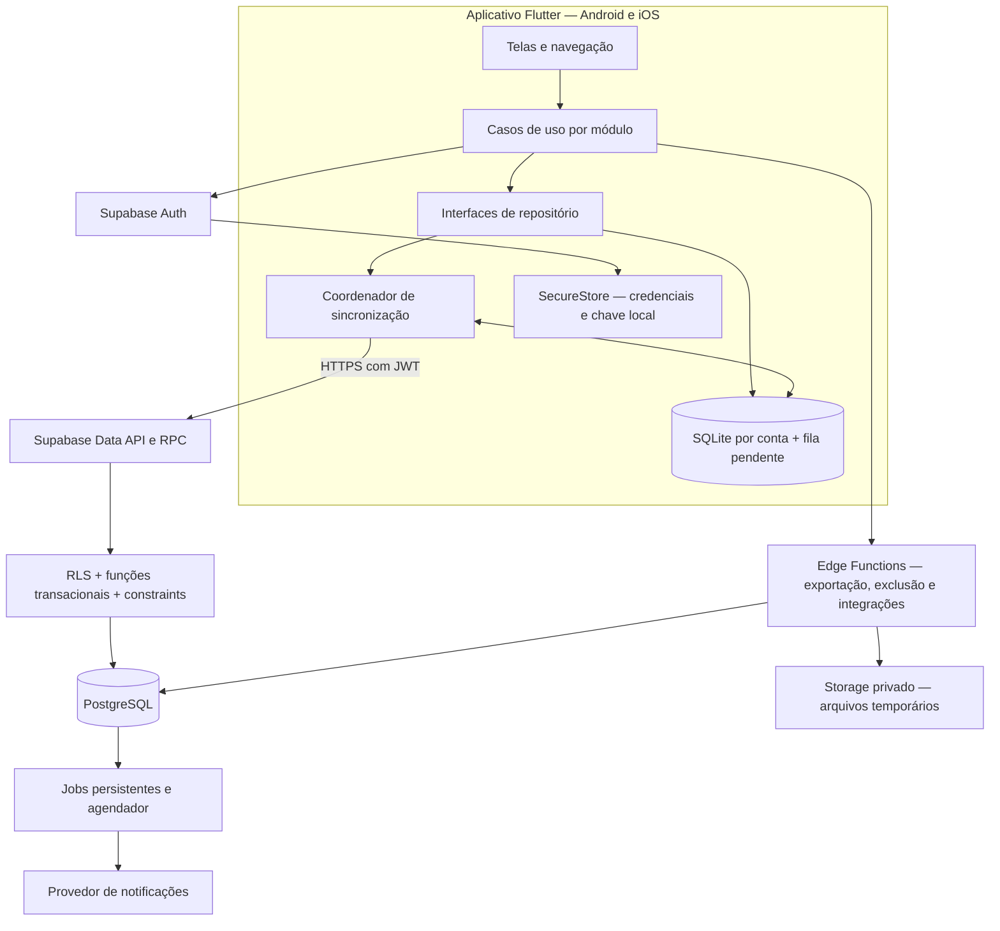
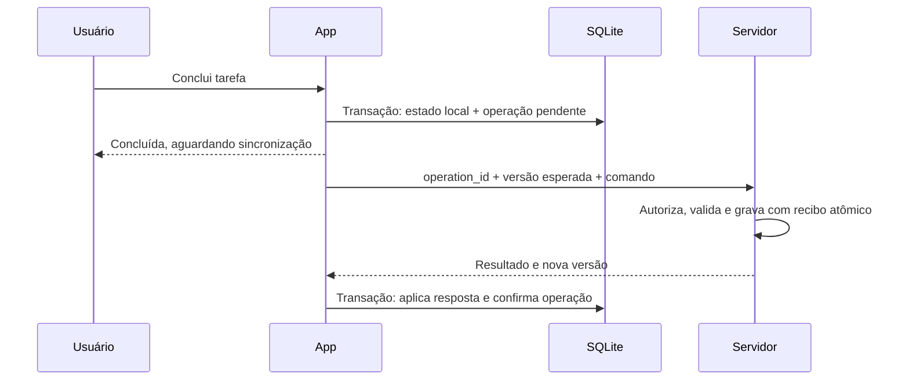

# Life OS — Arquitetura do aplicativo mobile

Data: 23/11/2026  
Status: proposta técnica para implementação; nenhuma infraestrutura provisionada.  
Referência de produto: [life-os.md](./life-os.md).

## 1. Objetivo e limites

Construir um aplicativo para Android e iOS que conecte áreas da vida, objetivos, projetos, tarefas, rotina, hábitos e revisão semanal. A experiência deve ser pessoal e acolhedora, adequada a consultas rápidas ao longo do dia, com acessibilidade e baixo esforço de organização.

Esta arquitetura substitui a sugestão web com Next.js do PRD. Mantém suas regras de domínio e a entrega progressiva. Finanças, conhecimento e IA têm pontos de extensão definidos, mas ficam fora do primeiro lançamento.

Nenhuma arquitetura garante ausência de falhas. A proposta reduz riscos com restrições no banco, operações atômicas, recuperação de gravações interrompidas, publicação gradual e restauração ensaiada. As metas de confiabilidade deste documento são critérios de validação futuros, não garantias já comprovadas.

Decisões assumidas: produto individual, múltiplos usuários com dados isolados, português e BRL inicialmente, múltiplos dispositivos por conta, Android e iOS desde o início. Infraestrutura gerenciada e orçamento inicial controlado.

## 2. Abordagem escolhida

| Abordagem | Benefício | Custo e decisão |
|---|---|---|
| Flutter + Supabase, módulos no app e regras transacionais no PostgreSQL | Entrega rápida, banco relacional e poucas peças operacionais | Escolhida como proposta; exige disciplina com RLS, contratos e sincronização |
| Flutter + API própria em Node.js + PostgreSQL | Controle completo das rotas e processamento | Mais autenticação, infraestrutura e manutenção; considerar quando houver necessidade concreta |
| Aplicativos separados em Swift e Kotlin | Controle específico de cada plataforma | Duas implementações e maior custo; inadequado para o início individual |

O backend será um monólito modular apoiado pelo Supabase. Não haverá um serviço independente para cada módulo. Regras atômicas de dados ficam em funções PostgreSQL; integrações e operações administrativas ficam em Edge Functions.

## 3. Visão geral



As setas representam chamadas autorizadas, não acesso irrestrito. O aplicativo nunca recebe credenciais administrativas. Realtime, quando adotado, apenas sinaliza que há dados para atualizar; consultas ao servidor continuam sendo o mecanismo de reconciliação.

## 4. Stack e responsabilidades

| Camada | Tecnologia proposta | Responsabilidade |
|---|---|---|
| Aplicativo | Flutter + Dart com null safety | Um projeto para Android e iOS |
| Navegação | go_router | Rotas, deep links e separação entre sessão pública e autenticada |
| Interface | Widgets próprios + tokens de tema Flutter | Tema, tipografia, espaçamento, acessibilidade e estados consistentes |
| Animação | Animações Flutter nativas; usar ImplicitlyAnimatedWidget e AnimationController conforme necessidade | Transições e gestos sem bloquear a interface |
| Formulários | flutter_form_builder ou formulários Flutter + validação tipada | Entrada e validação de dados |
| Cache remoto | Riverpod providers com cache e invalidação | Consultas online, invalidação e estado de requisições |
| Estado local de interface | Riverpod para estado local e compartilhado com escopo explícito | Filtros, modais e preferências temporárias |
| Persistência local | Drift sobre SQLite com SQLCipher habilitado em builds de produção | Dados locais e fila durável de operações |
| Credenciais | flutter_secure_storage / Keychain / Android Keystore | Sessão e chave do banco local, respeitando limites da plataforma |
| Backend | Supabase Auth, PostgreSQL, RPC e Edge Functions | Identidade, dados e operações protegidas |
| Arquivos | Supabase Storage privado, quando necessário | Exportações temporárias e anexos futuros |
| Gráficos | fl_chart ou CustomPainter para radar acessível | Roda da vida acessível com alternativa textual |
| Datas | Biblioteca com suporte explícito a fuso IANA | Datas locais, instantes e mudanças de fuso |
| Notificações | flutter_local_notifications + FCM/APNs quando push remoto for necessário | Lembretes locais e push quando necessário |
| Erros e desempenho | Sentry com filtragem de dados pessoais | Falhas, regressões e tempo de resposta |
| Build e distribuição | Codemagic ou GitHub Actions com Fastlane; publicação gradual nas lojas | Binários, publicação e atualizações compatíveis |
| Automação | GitHub Actions | Qualidade, migrações e entrega controlada |

Usar Material 3 como base de acessibilidade com tema próprio, sem deixar o visual genérico. Para reduzir dependências, o radar inicial pode ser desenhado com CustomPainter. SQLCipher exige configurar e validar os plugins nativos em builds de desenvolvimento e produção, em aparelhos reais.

Fixar versões no início da implementação, usar lockfile e fixar versões de pacotes Dart e plugins Flutter compatíveis. Este documento não fixa números de versões que podem mudar antes do desenvolvimento.

## 5. Estrutura do repositório

```text
apps/mobile/
  lib/
    app/                       # rotas, tema e composição
    modules/
      identity/
      life-areas/
      assessments/
      goals/
      projects/
      tasks/
      planning/
      habits/
      reviews/
      settings/
    core/
      auth/
      database/                # SQLite, migrações e adaptadores
      sync/                    # fila, retries e conflitos
      network/
      observability/
      notifications/
    shared/
      ui/
      theme/
      dates/
packages/
  contracts/                   # contratos documentados e exemplos JSON
supabase/
supabase/
  migrations/
  functions/
  tests/
docs/
  adr/                         # registro de decisões e alternativas
  runbooks/                    # procedimentos operacionais
```

Cada módulo pode conter `domain`, `application`, `data` e `presentation`, criados conforme a necessidade. Fluxo de dependência: apresentação → aplicação → domínio; adaptadores de dados implementam contratos usados pela aplicação. O domínio não importa SDKs ou componentes visuais.

Rotas não contêm consultas SQL nem regras de negócio. Um módulo acessa outro por uma interface pública; não importa seus arquivos internos. Evitar camadas sem responsabilidade real e abstrações genéricas para todos os CRUDs.

## 6. Módulos e experiência mobile

| Módulo | Responsabilidade e fronteira |
|---|---|
| Identidade | Login, recuperação, sessão, dispositivos, onboarding e conta |
| Áreas e avaliações | Áreas personalizáveis, roda da vida e histórico |
| Objetivos | Visão, objetivos anuais, metas trimestrais e progresso de resultados |
| Projetos | Entregas, próxima ação e progresso operacional |
| Tarefas | Captura, organização, datas, status e conclusão |
| Planejamento | Prioridades diárias/semanais e blocos de tempo |
| Hábitos | Programação, pausas, registros e adesão |
| Revisões | Rascunhos e conclusão da revisão semanal |
| Configurações | Preferências, privacidade, exportação e exclusão |

Navegação principal proposta: Hoje, Planejar, Hábitos e Vida. Captura rápida disponível globalmente. Projetos e metas aparecem em Planejar; roda da vida e revisões em Vida. Configurações pelo perfil. Validar essa organização com protótipo antes de desenvolver todas as telas.

A tela Hoje combina dados dos módulos por um caso de uso de leitura. Ela não se torna proprietária de tarefas ou hábitos. Carregamento parcial permite mostrar tarefas locais enquanto o restante atualiza. Estados de erro incluem uma ação de recuperação; ações pendentes exibem status de sincronização.

## 7. Modelo de dados

`auth.users` gerencia a identidade. `profiles` armazena idioma, fuso IANA, início da semana e onboarding. Não duplicar senha ou tokens no perfil.

Entidades de usuário usam UUID, `user_id`, `created_at`, `updated_at`, `version` inteiro e, onde houver exclusão sincronizável, `deleted_at`. Datas geradas no servidor não dependem do relógio do aparelho. Registros históricos não são sobrescritos por novas avaliações.

| Grupo | Tabelas principais e detalhes |
|---|---|
| Perfil | `profiles`, `user_devices` com token push e última atividade |
| Vida | `life_areas`, `assessments`, `assessment_scores` |
| Metas | `goals` com pai, horizonte, métrica, unidade, direção e progresso manual |
| Projetos | `projects`, com área obrigatória após organização e objetivo opcional |
| Tarefas | `tasks`, com área/projeto opcionais na captura, prazo e data planejada distintos |
| Planejamento | `daily_plans`, `daily_priorities`, `weekly_plans`, `weekly_priorities`, `time_blocks` |
| Hábitos | `habits`, `habit_schedule_versions`, `habit_pause_periods`, `habit_logs` |
| Revisões | `weekly_reviews`, com respostas JSONB versionadas e status de rascunho/concluído |
| Operação | `mutation_receipts`, `background_jobs`, `notification_deliveries`, `account_deletion_requests` |
| Futuro | `transactions`, `financial_categories`, `budgets`, `notes` e vínculos explícitos |

`daily_plans` e `weekly_plans` também servem de unidade de bloqueio e versão para alterações concorrentes. O histórico da programação dos hábitos permite calcular adesão de semanas anteriores sem aplicar retroativamente a frequência atual.

### Restrições obrigatórias no servidor

- Nota entre 0 e 10 e unicidade por avaliação/área; média considera apenas áreas avaliadas.
- Chaves estrangeiras compostas com `user_id` impedem associação a registros de outra conta. Para isso, as tabelas referenciadas têm unicidade em `(user_id, id)`.
- Metas sem ciclos e com hierarquia válida: visão → anual → trimestral. Mudanças de hierarquia bloqueiam a unidade de planejamento da conta para evitar ciclos por requisições simultâneas.
- Até três objetivos trimestrais ativos gera aviso, com exceção registrada conscientemente; não transformar recomendação em bloqueio absoluto.
- Prioridades diárias com posição entre 1 e 3, únicas por usuário/data/posição e por usuário/data/tarefa.
- Três prioridades semanais como padrão do fluxo do PRD; substituição explícita.
- Um registro de hábito por usuário/hábito/data; uma revisão por usuário/início da semana.
- Fim de bloco posterior ao início; sobreposição pode gerar aviso sem impedir gravação.
- Estados e transições validados. Canceladas não entram no denominador do progresso operacional de projetos; com denominador zero, apresentar sem progresso definido.
- Concluir tarefas não conclui automaticamente uma meta. Métricas de crescimento/redução e metas com alvo igual ao início têm cálculo explícito; limitar apresentação a 0–100%, preservando o valor real.
- Arquivar preserva vínculos e histórico. Exclusão definitiva é outra operação.

Índices iniciais acompanham os acessos: tarefas por usuário/data planejada/status, tarefas por projeto, metas por usuário/horizonte/status, hábitos e registros por usuário/data, blocos por usuário/início, revisões por usuário/semana. Criar índice de toda coluna usada por política de acesso ou FK quando necessário. Listas históricas usam paginação por cursor; evitar carregar todo o histórico no celular.

## 8. Datas e calendário

Datas de planejamento, registro de hábito e prazo diário usam `date` local; blocos usam `timestamptz` e guardam o fuso de origem quando necessário. Strings ISO são o contrato de transporte. Não converter uma data sem horário em meia-noite UTC para calcular o dia.

Semana começa na segunda-feira por padrão. Uma mudança futura dessa preferência não reclassifica revisões já salvas. Mudança de fuso preserva registros históricos e solicita confirmação antes de reagendar lembretes. Datas e regras de recorrência usam identificadores IANA, como `America/Sao_Paulo`, incluindo cenários de horário de verão.

Recorrência avançada fica para V2: guardar série, fuso, regra e exceções, gerando apenas uma janela limitada de ocorrências. Nunca criar infinitos registros antecipadamente.

## 9. Contratos e transações

Leituras simples podem usar a Data API sob RLS. Gravações passam pelos repositórios e usam RPC para operações com invariantes, idempotência ou versões. Validadores Dart e conversores tipados validam entrada e saída no app, sem substituir constraints e validação do servidor.

Comandos de escrita recebem `operation_id`, `expected_version` quando aplicável e payload tipado. A resposta contém ID, versão, horário do servidor e resultado persistido. Códigos previsíveis: `VALIDATION_ERROR`, `UNAUTHENTICATED`, `FORBIDDEN`, `CONFLICT`, `LIMIT_REACHED`, `RATE_LIMITED`, `UNAVAILABLE`. Mensagens exibidas são traduzidas no app.

RPCs propostas: `create_task`, `update_task`, `set_task_status`, `replace_daily_priorities`, `set_habit_completion`, `update_goal_progress`, `save_weekly_review`, `complete_weekly_review` e `move_goal`. Definir a assinatura exata na implementação.

Exemplo: `replace_daily_priorities` garante o registro do dia, bloqueia esse registro, verifica versão e propriedade das tarefas e substitui a lista em uma única transação. Não executar apagar e inserir em requisições separadas. Duas alterações concorrentes no mesmo dia produzem um conflito recuperável.

`mutation_receipts` registra usuário, identificador da operação, hash do payload e resposta na mesma transação da alteração. Repetição com mesmo payload devolve o resultado anterior; mesmo identificador com payload diferente é rejeitado. Prazo proposto de retenção: 90 dias; operações mais antigas exigem reconciliação antes de reenviar. Chaves naturais únicas continuam protegendo hábitos e prioridades depois desse prazo.

Edge Functions validam identidade novamente e não pressupõem autorização por conhecer um ID. Chamadas ao banco que precisam ser atômicas invocam uma função transacional; uma sequência de chamadas em uma Edge Function não constitui uma transação automaticamente.

## 10. Offline e sincronização

O PostgreSQL é a fonte oficial entre dispositivos. SQLite mantém uma cópia local com metadados de sincronização. Riverpod providers mantêm estado de interface; SQLite é a fonte de leitura local para entidades offline: para tarefas e hábitos offline, a leitura vem do repositório SQLite; o cache remoto atende operações online e projeções não persistidas localmente.

Escopo inicial offline: consultar dados previamente carregados, capturar tarefas, alterar conclusão de tarefas e marcar/desmarcar hábitos. Login inicial, troca de conta, prioridades concorrentes, alterações estruturais de metas, exportação e exclusão exigem conexão. Não prometer que todo o app funciona offline.



### Protocolo inicial

1. Toda alteração offline grava entidade e fila na mesma transação SQLite. Sem isso, o app poderia mostrar sucesso e perder a operação ao encerrar.
2. Um coordenador por conta processa operações, preservando ordem por entidade. Criações pendentes são confirmadas antes de operações dependentes.
3. Reenviar usa o mesmo `operation_id`. Se a conexão cair após o commit remoto, o recibo evita duplicação.
4. Retry apenas para falhas transitórias, com espera exponencial, aleatoriedade e respeito a limites do servidor. Erro de validação vai para estado de intervenção; não repetir infinitamente.
5. Ao iniciar, voltar ao primeiro plano ou recuperar rede, enviar pendências e atualizar as coleções locais por páginas. Execução em segundo plano é uma otimização, nunca requisito para salvar dados.
6. No MVP, reconciliar snapshots paginados completos das coleções pequenas do usuário, incluindo IDs excluídos logicamente. Aplicar o snapshot em staging local e só substituir a coleção após concluir o download. Mesclar por versão e preservar alterações pendentes.
7. Uma gravação concorrente durante a paginação pode aparecer apenas na próxima reconciliação; reconciliações repetidas precisam convergir. Operações críticas sempre consultam o estado atual no servidor. Não prometer snapshot global consistente usando chamadas paginadas comuns.
8. Com volume que inviabilize snapshots, introduzir feed incremental durável com sequência segura de commit, checkpoint consistente e ressincronização completa. Não usar apenas `updated_at > último_horário`, nem assumir que IDs sequenciais representam ordem de commit.

### Política de conflitos

| Situação | Tratamento |
|---|---|
| Versão atual diferente da esperada | Servidor retorna conflito e versão atual; preservar intenção local |
| Tarefa alterada em dois aparelhos | Mostrar versões atual/local e permitir reaplicar conscientemente |
| Hábito marcado e desmarcado em aparelhos diferentes | Controle de versão e conflito; não usar relógio do dispositivo como árbitro |
| Registro excluído no servidor com edição local pendente | Preservar edição para consulta; oferecer copiar como novo registro |
| Sessão expirada | Pausar sincronização e pedir autenticação; manter fila na mesma conta |
| Logout com fila pendente | Avisar e oferecer sincronizar ou descartar explicitamente; limpar dados e chaves ao finalizar logout |
| Conta diferente | Banco local, cache, fila e credenciais isolados; nunca reaproveitar fila da conta anterior |

Fila local distingue `pending`, `sending`, `confirmed`, `conflict` e `failed`. Ao reiniciar, operações em `sending` voltam para tentativa com a mesma chave. Pendências devem ser visíveis em uma tela de sincronização e nunca desaparecer silenciosamente.

## 11. Autenticação, autorização e privacidade

- Supabase Auth com e-mail/senha e recuperação inicialmente; provedores sociais podem entrar depois com requisitos das lojas avaliados.
- Sessão adaptada a armazenamento seguro nativo, incluindo estratégia para tamanhos superiores ao limite do SecureStore. Não manter tokens em logs ou SQLite sem proteção.
- RLS em todas as tabelas expostas. Políticas SELECT/INSERT/UPDATE/DELETE vinculadas à identidade autenticada, com `USING` e `WITH CHECK` apropriados. Estado de conta ativa também precisa bloquear operações sensíveis durante exclusão.
- Funções usam `SECURITY INVOKER` por padrão. Exceção privilegiada exige justificativa, permissões mínimas, `search_path` fixo e checagem explícita de identidade. Revogar execução pública por padrão e conceder só às funções necessárias.
- Views expostas respeitam RLS com `security_invoker` onde suportado. Papéis do cliente não podem alterar propriedade, versão ou campos gerados pelo servidor.
- Chave publishable no app; `service_role` e segredos somente no servidor. Variáveis `--dart-define` compiladas no app são públicas.
- Deep links de autenticação usam destinos permitidos e validação de estado/PKCE conforme o fluxo suportado. Recuperação de senha tem tela própria.
- SQLCipher protege o arquivo local; chave no armazenamento seguro. Configurar backups do sistema para não exportar dados locais sensíveis indevidamente. Isso não protege um aparelho já desbloqueado e comprometido.
- Exportações privadas com link temporário e limpeza automática. Logs de erro removem títulos, notas, respostas de revisão e tokens. Push mostra texto discreto por padrão.
- Telemetria limitada ao necessário, com preferências documentadas. Avaliar bases legais, retenção e atendimento de direitos para o público atendido antes da publicação.

Exclusão de conta é um job retomável: reautenticar, marcar conta como bloqueada, revogar sessões, impedir novas gravações, remover dados e arquivos ativos, excluir identidade e registrar somente o mínimo operacional. JWT já emitido pode continuar válido até expirar; o bloqueio de conta precisa ser verificado no servidor. Backups seguem prazo de expiração documentado; após restauração, reaplicar solicitações de exclusão.

## 12. Jobs, notificações e integrações

Lembretes do próprio aparelho podem ser locais. Push remoto atende eventos que dependem do servidor. Pedir permissão quando o usuário configurar um lembrete. Guardar preferência, fuso, horário de silêncio e tokens por dispositivo; invalidar tokens rejeitados.

Jobs duráveis têm chave de deduplicação, estado, próxima tentativa, quantidade de tentativas e prazo de lease. Worker adquire trabalho de forma atômica e libera/reprocessa após expiração. Efeitos externos precisam de idempotência e reconciliação; não é possível prometer entrega exatamente uma vez quando um provedor não oferece esse recurso.

Conclusão de um job não depende de o aplicativo permanecer aberto. Uma notificação atrasada ou duplicada não altera o estado de uma tarefa. Integrações futuras guardam credenciais no servidor, validam webhooks e usam caixa de saída transacional para eventos gerados por gravações.

## 13. Confiabilidade, observabilidade e desempenho

Metas iniciais a validar em staging e beta:

| Indicador | Objetivo proposto |
|---|---|
| Sessões sem crash | Pelo menos 99,5% em janela de 30 dias |
| Disponibilidade dos comandos do backend | 99,5% mensal, medida pelo produto e limitada pelos fornecedores |
| Interação local de conclusão | Resposta visual em até 150 ms no aparelho de referência |
| Hoje com cache local | Conteúdo útil em até 1 segundo após abrir a tela |
| Comandos remotos comuns | p95 abaixo de 1 segundo sob carga de referência definida no beta |
| Pendências após reconexão | Monitorar tempo de convergência e alertar sobre fila parada |

Relatórios incluem versão do app, runtime, ambiente, identificador de requisição/operação e código do erro. Separar falhas de conectividade de falhas internas. Alertas acompanham aumento de crashes, falhas de autenticação, fila de jobs, latência e erros de banco. Medir uso real antes de otimizar.

Consultas limitadas por período e paginação, índices validados com plano de execução e componentes de lista virtualizados. A tela Hoje carrega apenas o período relevante. Reduzir frequência de sincronização em rede móvel/bateria baixa sem comprometer gravações locais. Tamanhos, períodos de retenção e limites de API são configuráveis no servidor.

## 14. Ambientes, migrações e publicação

- Local, staging e produção separados, com projetos Supabase e credenciais distintos. Staging usa dados fictícios. Aplicativos de desenvolvimento têm identificadores próprios.
- Migrações SQL e SQLite versionadas no Git. Alteração manual de produção deve ser excepcional e imediatamente reconciliada no histórico.
- PostgreSQL segue expansão → migração de dados → adoção pelos clientes → remoção posterior. Clientes móveis antigos podem ficar instalados por meses.
- Contratos aditivos por padrão. Mudanças incompatíveis recebem nova versão de RPC e janela de suporte explícita. Definir versões mínimas com tela de atualização, sem bloquear acesso a pendências locais silenciosamente.
- Migrações SQLite são transacionais quando possível e nunca apagam fila pendente para corrigir um erro. Falha abre modo de recuperação. Perda da chave local exige fluxo claro; não fingir que o banco pode ser reconstruído com pendências que nunca chegaram ao servidor.
- GitHub Actions executa lint, checagem de tipos, testes de regras, testes de banco e verificação de migrações. Builds de release geram artefatos reproduzíveis com lockfile e segredos protegidos.
- Atualizações nativas são publicadas como novos binários nas lojas e passam por staging e distribuição gradual. Não aplicar atualização de Dart que contorne as regras de revisão das lojas; correções críticas usam o canal oficial de publicação.
- Rollback de versão do app também precisa ser compatível com o esquema SQLite já migrado. Migrações do backend favorecem correção aditiva; restauração de backup não é o procedimento normal de rollback de código.

## 15. Backups e recuperação

Escolher plano e recursos do provedor que atendam às metas abaixo; confirmar cobertura, retenção, região e custos antes de produção. Backup de banco não deve ser presumido como backup dos arquivos do Storage.

Metas propostas para produção: RPO de até 1 hora para dados confirmados no servidor e RTO de até 4 horas. Exigem recuperação pontual e procedimento ensaiado; se o orçamento não permitir, registrar explicitamente metas menos exigentes antes de lançar. Dados ainda apenas no aparelho não entram na cobertura do backup remoto.

Runbooks obrigatórios: indisponibilidade do Supabase, falha de migração, versão móvel com crashes, fila parada, credencial vazada e recuperação de dados. Ensaio trimestral em ambiente isolado restaura banco e arquivos, verifica vínculos, RLS e solicitações de exclusão e mede RPO/RTO reais.

Se houver corrupção local, preservar arquivo e fila antes de qualquer tentativa de reconstrução. Não sugerir reinstalação como primeira solução para usuário com pendências. Ação de suporte não deve solicitar banco completo com conteúdo pessoal sem necessidade e consentimento.

## 16. Estratégia de validação

Esta seção define testes a implementar; nenhum teste de aplicativo foi executado para produzir este documento.

| Camada | Cenários necessários |
|---|---|
| Domínio | Progresso, prioridades, estados, adesão com pausas, datas e mudança de fuso |
| PostgreSQL | RLS entre duas contas, FKs por usuário, ciclos, constraints e transações |
| Concorrência | Duas gravações na terceira prioridade, alteração simultânea de hierarquia, repetição de comando |
| Sincronização | Encerrar app após gravação local; queda após commit remoto; retomada, conflitos e exclusões |
| Migrações | Banco vazio e versões anteriores com dados reais fictícios e fila pendente |
| Mobile E2E | Onboarding pulável, captura, metas, planejamento e revisão completa |
| Aparelhos | Android e iOS físicos, rede ruim, pouco espaço, permissões negadas e acessibilidade |
| Recuperação | Restore remoto, expiração de sessão, logout pendente e exclusão retomável |

Ferramentas propostas: testes Dart para regras, pgTAP/SQL para banco e Maestro para jornadas móveis. A escolha final depende da compatibilidade com o SDK. CI precisa bloquear publicação quando isolamento de contas, migrações ou idempotência falharem.

## 17. Evolução e sequência de entrega

1. Fundação: workspace, contratos, tema, autenticação, RLS, migrações, monitoramento e pipeline de staging.
2. Primeira jornada vertical: captura e listagem de tarefas, persistência remota/local, fila, idempotência e conflitos. Validar infraestrutura antes de multiplicar módulos.
3. Direção: áreas, avaliações, objetivos e projetos.
4. Execução: Hoje, prioridades, planejamento semanal e blocos simples.
5. Feedback: hábitos com histórico de programação, revisão semanal e evolução das avaliações.
6. Preparação de lançamento: exportação/exclusão, restore ensaiado, beta em aparelhos, acessibilidade e publicação gradual.
7. V2: finanças, notas, recorrência e integração com calendários.
8. V3: IA contextual com acesso mínimo e confirmação de alterações propostas.

Finanças usa valores inteiros em centavos e moeda explícita; estornos e mudanças preservam histórico, e saldo é calculado a partir de lançamentos. Notas terão formato de conteúdo versionado e limite de tamanho. IA acessa dados autorizados por ferramentas de aplicação, sem credenciais administrativas ou acesso livre ao banco; ações ficam registradas e podem ser revistas pelo usuário.

## 18. Critérios para a primeira publicação

- Jornada completa do PRD, de avaliação a revisão semanal, funciona com histórico persistido.
- Nenhuma conta acessa ou vincula registros de outra conta nos cenários de validação.
- Prioridades e comandos resistem a concorrência e repetição de requisições.
- Operações offline declaradas sobrevivem ao encerramento do processo e retomam sem duplicação.
- Conflitos e erros de sincronização ficam visíveis e preservam a intenção do usuário.
- Exportação, exclusão, restauração e rollback compatível foram exercitados.
- Android e iOS validados em aparelhos e com permissões negadas.
- Metas de desempenho e confiabilidade medidas no beta; custos, região, plano de backup e suporte definidos antes de produção.

## 19. Referências técnicas

Documentação consultada em 23/11/2026. As decisões deste documento são propostas do projeto; as fontes abaixo fundamentam recursos e limitações dos fornecedores.

- [Supabase — RLS](https://supabase.com/docs/guides/database/postgres/row-level-security): isolamento de linhas e autorização no banco.
- [Supabase — changelog](https://supabase.com/changelog.md): revisar mudanças relevantes ao fixar versões e automatizar CLI.
- [Flutter — documentação](https://docs.flutter.dev/): ferramentas e integração nativa.
- [Supabase Flutter](https://supabase.com/docs/reference/dart/introduction): cliente Dart oficial para Flutter.

Antes de implementar cada integração, confirmar sua documentação atual, limites e compatibilidade. Esta arquitetura descreve o sistema desejado; não comprova capacidade de infraestrutura, criptografia configurada ou metas operacionais atingidas.


