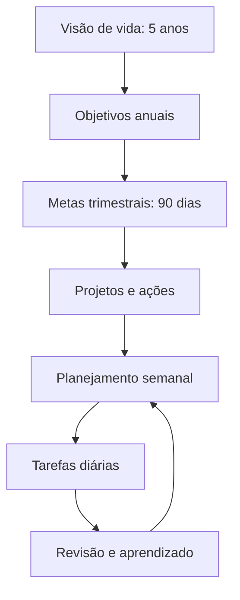
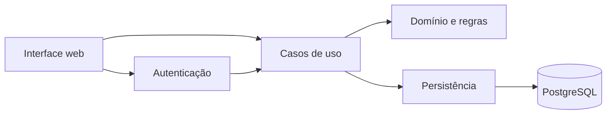

# Life OS — Sistema Operacional da Vida

> Documento de requisitos de produto (PRD) — v1.0

## 1. Visão do produto

Life OS é uma aplicação de organização pessoal que conecta visão de vida, objetivos, projetos, tarefas, hábitos, rotina e finanças em um único sistema.

Seu propósito é ajudar o usuário a saber onde está, onde quer chegar e o que precisa fazer hoje.

### Princípios

- Simplicidade antes de complexidade.
- No máximo três grandes objetivos ativos por trimestre (limite recomendado).
- No máximo três tarefas prioritárias por dia.
- Consistência antes de intensidade.
- Planejamento conectado à execução.
- Descanso também faz parte do planejamento.
- O sistema deve reduzir a carga mental, não aumentar a burocracia.

## 2. Problema e proposta de valor

Ferramentas tradicionais fragmentam a organização entre calendários, listas, planilhas e notas. O usuário consegue registrar tarefas, mas nem sempre entende como elas contribuem para seus objetivos.

O diferencial do Life OS é a rastreabilidade entre decisões estratégicas e ações cotidianas, acompanhada de revisões periódicas.

## 3. Áreas da vida

Cada usuário começa com oito áreas personalizáveis:

| Área | Exemplos |
|---|---|
| Saúde física | Exercícios, alimentação, sono |
| Saúde mental | Descanso, bem-estar, reflexão |
| Carreira | Evolução profissional, competências |
| Finanças | Orçamento, reserva, patrimônio |
| Estudos | Conhecimentos, cursos, leitura |
| Relacionamentos | Família, amigos, vida social |
| Projetos pessoais | Empreendedorismo, hobbies, iniciativas |
| Lazer | Recreação e tempo livre |

### Roda da vida

- Atribuir nota de 0 a 10 a cada área.
- Exibir gráfico radar interativo.
- Registrar avaliações com data e observações opcionais.
- Comparar avaliações anteriores.
- Exibir média das áreas avaliadas, sem tratar áreas não avaliadas como zero.
- Permitir selecionar áreas que precisam de atenção.
- A nota representa percepção subjetiva, não diagnóstico ou medida objetiva de sucesso.

## 4. Hierarquia de planejamento



Cada nível possui finalidade própria:

| Nível | Pergunta | Horizonte |
|---|---|---|
| Visão | Que vida quero construir? | 5 anos |
| Objetivo anual | O que quero conquistar? | 1 ano |
| Meta trimestral | Qual resultado preciso alcançar? | 90 dias |
| Projeto | Que conjunto de ações entrega esse resultado? | Variável |
| Plano semanal | O que precisa avançar nesta semana? | 7 dias |
| Tarefa | Qual é a próxima ação concreta? | Hoje |

Objetivos devem possuir área, descrição, prazo, critério de sucesso, status e progresso. Projetos e tarefas podem existir sem objetivo associado, pois nem toda obrigação cotidiana precisa servir a uma meta estratégica.

## 5. Módulos funcionais

### 5.1 Dashboard — Hoje

Tela inicial orientada à execução:

- Três prioridades do dia.
- Agenda e blocos de tempo.
- Tarefas pendentes e atrasadas.
- Hábitos previstos para hoje.
- Resumo dos objetivos ativos.
- Acesso rápido para capturar uma tarefa.
- Indicador de revisão semanal pendente.

### 5.2 Áreas da vida

Cadastro, edição, ordenação e arquivamento de áreas. Histórico da roda da vida e visualização dos objetivos associados a cada área.

### 5.3 Objetivos e metas

- Criar visão de longo prazo, objetivos anuais e metas trimestrais.
- Relacionar metas ao objetivo superior e à área correspondente.
- Definir resultado mensurável, valor inicial, valor desejado, unidade e prazo, quando aplicável.
- Permitir progresso manual para metas qualitativas.
- Status: planejado, ativo, pausado, concluído ou cancelado.
- Alertar ao exceder três objetivos trimestrais ativos, permitindo exceção consciente.

### 5.4 Projetos

- Nome, descrição, área, objetivo opcional, prazo e status.
- Lista de tarefas e próxima ação.
- Progresso operacional: tarefas concluídas / tarefas não canceladas.
- Não confundir conclusão de tarefas com alcance do resultado de uma meta.

### 5.5 Tarefas

- Caixa de entrada para captura rápida.
- Título, descrição, prazo, data planejada, prioridade, estimativa de duração e projeto opcional.
- Status: pendente, em andamento, concluída ou cancelada.
- Filtros por área, projeto, data e status.
- Reagendamento explícito de tarefas pendentes.
- Seleção de até três prioridades por dia; substituir uma prioridade quando o limite for atingido.

### 5.6 Rotina e calendário

- Visualização diária e semanal.
- Blocos de tempo para trabalho, estudo, projetos, exercícios e lazer.
- Eventos recorrentes e edição de exceções em versões futuras.
- Avisos de conflitos, sem impedir sobreposições intencionais.

Exemplo de rotina fora do trabalho:

| Dia | Foco |
|---|---|
| Segunda | Estudos técnicos |
| Terça | Produto digital |
| Quarta | Estudos técnicos |
| Quinta | Produto digital |
| Sexta | Lazer e vida social |
| Sábado | Projetos pessoais e descanso |
| Domingo | Revisão e planejamento |

### 5.7 Hábitos

Cadastro de hábitos, frequência semanal, registro diário e histórico. Calcular adesão por oportunidades previstas, não simplesmente por dias corridos. Permitir pausa sem penalizar o usuário.

### 5.8 Finanças pessoais

Módulo de evolução posterior ao MVP:

- Registro manual de receitas e despesas.
- Categorias e orçamento mensal.
- Metas financeiras e evolução da reserva.
- Histórico mensal e exportação.
- Sem integração bancária no primeiro lançamento.
- Valores monetários armazenados em centavos inteiros, com moeda BRL inicialmente.

### 5.9 Revisão semanal

Fluxo guiado de 20 a 30 minutos:

1. Revisar tarefas concluídas e pendências.
2. Identificar obstáculos e aprendizados.
3. Revisar finanças, quando o módulo estiver disponível.
4. Avaliar hábitos e bem-estar.
5. Atualizar progresso das metas.
6. Definir três prioridades da próxima semana.
7. Distribuir ações na agenda.

Salvar respostas, prioridades, período e data da conclusão. Permitir rascunho e consulta ao histórico.

### 5.10 Conhecimento e notas

Módulo futuro para registrar aprendizados, ideias, decisões e referências, com associação opcional a projetos e áreas. Não construir um editor de documentos completo no MVP.

## 6. Navegação

```text
Life OS
├── Hoje
├── Planejamento
│   ├── Visão de vida
│   ├── Objetivos e metas
│   └── Projetos
├── Tarefas
├── Calendário
├── Áreas da vida
├── Hábitos
├── Revisões
├── Finanças (futuro)
├── Conhecimento (futuro)
└── Configurações
```

Interface responsiva, navegação lateral no desktop e navegação simplificada no celular. Priorizar acessibilidade, contraste adequado, teclado e estados vazios úteis.

## 7. Jornada do usuário

1. Criar conta e configurar fuso horário.
2. Avaliar as oito áreas da vida.
3. Definir até três metas para os próximos 90 dias.
4. Criar projetos e próximas ações.
5. Organizar a semana e escolher as prioridades de hoje.
6. Executar e registrar progresso.
7. Realizar revisão semanal.
8. Reavaliar as áreas periodicamente e ajustar o planejamento.

Onboarding deve ser opcionalmente pulável e retomável. Não exigir configuração completa antes de usar a lista de tarefas.

## 8. Modelo de domínio

Todos os dados pessoais devem ser isolados por usuário.

| Entidade | Campos principais |
|---|---|
| User | id, timezone, locale |
| LifeArea | id, user_id, name, archived_at |
| Assessment | id, user_id, assessed_at, notes |
| AssessmentScore | assessment_id, area_id, score |
| Goal | id, user_id, area_id, parent_id, horizon, title, target_date, status, metric_baseline, metric_current, metric_target, metric_unit, manual_progress |
| Project | id, user_id, area_id, goal_id, title, status, due_date |
| Task | id, user_id, area_id, project_id, title, status, planned_date, due_date, priority, estimated_minutes |
| DailyPriority | user_id, local_date, task_id, position |
| WeeklyPriority | user_id, week_start, title, goal_id, position |
| TimeBlock | id, user_id, task_id, title, starts_at, ends_at |
| Habit | id, user_id, area_id, title, scheduled_weekdays, status |
| HabitLog | habit_id, local_date, completed |
| WeeklyReview | id, user_id, week_start, answers, status, completed_at |
| Transaction (futuro) | id, user_id, type, category, amount_minor, currency, occurred_on |
| Note (futuro) | id, user_id, project_id, title, content |

### Invariantes

- Notas da roda da vida entre 0 e 10.
- Uma nota por área em cada avaliação.
- Metas não podem formar ciclos na hierarquia.
- Relações entre entidades devem pertencer ao mesmo usuário.
- Prioridades diárias: posições únicas de 1 a 3 por usuário e data; uma tarefa não pode aparecer duas vezes no mesmo dia.
- Uma revisão por usuário e semana.
- Um registro de hábito por hábito e dia.
- Horário de término do bloco deve ser posterior ao início.
- Datas de planejamento são locais; instantes de calendário são armazenados com fuso/UTC.
- Arquivamento preserva histórico e vínculos existentes.

## 9. Arquitetura sugerida

Para um projeto individual, começar com um monólito modular, sem microserviços.

- Frontend e backend web: Next.js + TypeScript.
- Interface: Tailwind CSS e componentes acessíveis.
- Banco: PostgreSQL.
- Autenticação: provedor gerenciado ou biblioteca consolidada.
- Gráficos: biblioteca com suporte a radar e séries temporais.
- Validação: esquemas compartilhados entre cliente e servidor.
- Testes: unitários para regras de domínio, integração para persistência, E2E para jornadas principais.

A stack é uma sugestão substituível; as regras de domínio são independentes dela.



Organizar módulos por domínio: areas, goals, projects, tasks, planning, habits, reviews e identity. Validar autorização e regras no servidor, não apenas na interface.

## 10. Escopo do MVP e roadmap

| Fase | Entregas |
|---|---|
| MVP 1 — Fundação | Autenticação, áreas, roda da vida, objetivos, projetos |
| MVP 2 — Execução | Tarefas, três prioridades diárias, dashboard Hoje, planejamento semanal |
| MVP 3 — Feedback | Revisão semanal, histórico de avaliações, hábitos e blocos simples de tempo |
| V2 | Finanças, notas, notificações, recorrências avançadas, integração com calendário |
| V3 | Assistente de IA contextual, análises de tendências, sugestões de planejamento |

Fora do MVP: colaboração, gamificação complexa, microserviços, integrações bancárias, aplicativo nativo e automações autônomas com IA.

## 11. Backlog inicial e critérios de aceitação

| ID | História | Critério mínimo |
|---|---|---|
| US-01 | Como usuário, quero avaliar minhas áreas | Salvar notas válidas e consultar avaliações anteriores |
| US-02 | Quero definir metas | Criar, editar, associar área e atualizar progresso |
| US-03 | Quero dividir metas em projetos | Criar projeto associado e visualizar suas tarefas |
| US-04 | Quero capturar tarefas rapidamente | Criar tarefa apenas com título e organizá-la depois |
| US-05 | Quero escolher prioridades diárias | Quarta prioridade exige substituição; servidor garante o limite |
| US-06 | Quero visualizar meu dia | Exibir tarefas, prioridades e blocos da data local |
| US-07 | Quero planejar minha semana | Salvar prioridades semanais e distribuir ações pelos dias |
| US-08 | Quero registrar hábitos | Registrar conclusão uma única vez por dia e consultar histórico |
| US-09 | Quero revisar minha semana | Salvar rascunho, concluir e consultar revisão anterior |
| US-10 | Quero controlar meus dados | Exportar meus registros e solicitar exclusão da conta |

## 12. Requisitos não funcionais

- Autorização por usuário em todas as operações.
- Criptografia em trânsito e proteção de dados armazenados.
- Não registrar conteúdo pessoal sensível em logs técnicos.
- Exportação de dados em JSON ou CSV e exclusão de conta.
- Backups e procedimento testado de restauração.
- Interface responsiva com estados de carregamento, erro e sucesso.
- Operações críticas protegidas contra duplicidade e concorrência.
- Testes de isolamento de dados entre contas.

## 13. Indicadores de sucesso

- Ativação: proporção de novos usuários que criam uma meta e uma tarefa na primeira semana.
- Adoção: proporção de usuários ativos que definem prioridades diárias.
- Revisão: proporção de usuários ativos na semana que concluem sua revisão.
- Retenção: proporção de usuários ativados que voltam na quarta semana.
- Utilidade percebida: avaliação voluntária da clareza e organização proporcionadas pelo sistema.

Evitar otimizar somente número de tarefas concluídas ou tempo gasto no app. O objetivo é melhorar a vida fora da aplicação.

## 14. Definição de pronto do MVP

O MVP está pronto quando um usuário consegue avaliar sua vida, estabelecer metas, desdobrá-las em projetos e tarefas, organizar a semana, executar prioridades diárias e concluir uma revisão semanal, com persistência segura e histórico recuperável.

A primeira versão deve entregar esse ciclo completo antes de adicionar funcionalidades sofisticadas.
